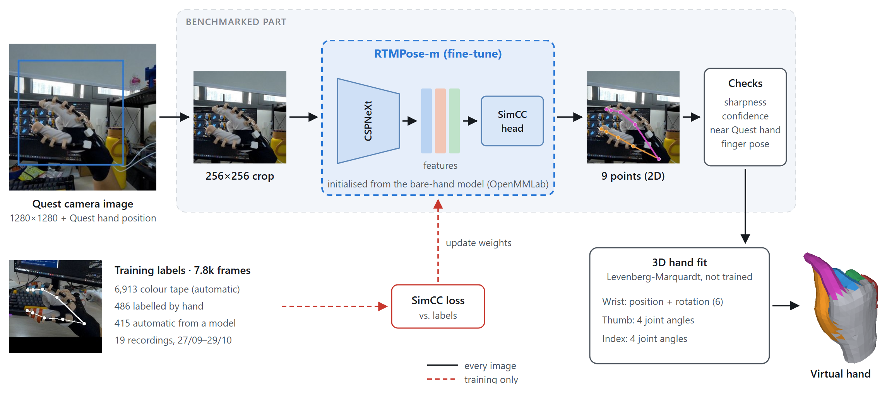
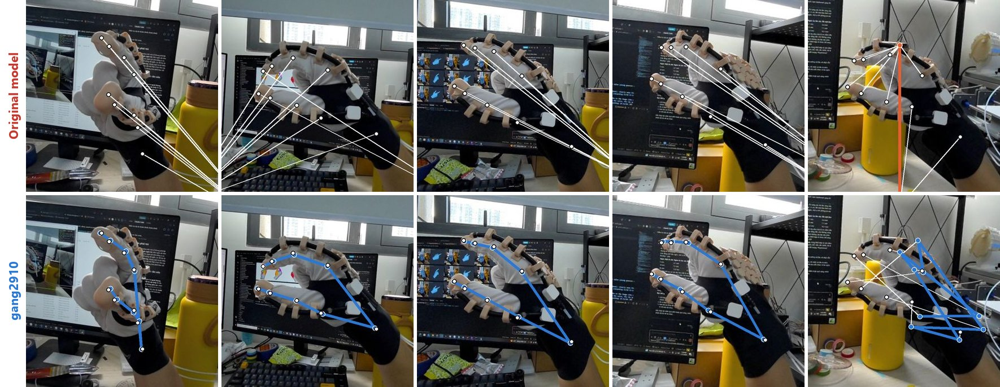

# Grasping and releasing with a haptic glove in VR

A Meta Quest 3 VR study setup: the user wears a pneumatic haptic glove, picks up and squeezes virtual objects with
the thumb and index finger, and feels the contact force through actuators on the glove.

The Quest cannot track a gloved hand well, so the glove hand is rebuilt from the headset's own colour camera:
the camera image goes to a PC, an RTMPose model trained on the glove finds the finger points, and Unity fits a
virtual hand to those points. The force computed from virtual contact goes back out through a PC relay to an
Arduino Mega that drives the actuators.

See [docs/ARCHITECTURE.md](docs/ARCHITECTURE.md) for the data flow and what every script does.

## Repository layout

| Folder | Contents |
|---|---|
| `Assets/Scripts/Tracking/` | Camera streaming, receiving the model's points, building the glove hand from the image |
| `Assets/Scripts/Haptics/` | Contact -> force signals and the haptic outputs (`GloveForceEsp32Output.cs` and `GloveEsp32Protocol.cs` sit in `Assets/Scripts/` because the end-to-end test compiles them from there) |
| `Assets/Scripts/Interaction/` | Squeezable and rigid virtual objects, keeping virtual fingers on their surface, visual cues |
| `Assets/Scripts/Experiments/` | Stiffness discrimination experiment and CSV logging |
| `Assets/Scripts/Measurement/` | Finger length measurement (force model input) and bare-hand pose recording |
| `Assets/Editor/` | `HandImageFitBench`: tests the hand fit in the Editor on simulated data and recordings |
| `Assets/Scenes/SampleScene.unity` | The only scene |
| `arduino/` | Arduino Mega sketch for the actuators and the serial-line parser |
| `tools/` | PC relay to the Arduino (`glove_serial_bridge.py`, `dorsal_pressure.py`, `actuator_model/`), simulators and tests |
| `tools/analysis/` | Scripts that analyse logs pulled from the headset (latency, filter tuning, finger lengths) |

The Python program that runs the hand model (`run_glove_quest_stream.py`, its labelling and training scripts, and the
trained checkpoint) is **not in this repository**; it lives with its own virtual environment on the lab PC.

## Requirements

- Unity 6000.4.2f1 with Android build support, Meta XR SDK 205 (`com.meta.xr.sdk.all`)
- Meta Quest 3 with passthrough camera access enabled for the app
- A PC on the same Wi-Fi network, with an NVIDIA GPU, running the hand-model program
- For the glove: Arduino Mega on USB, Python 3 with `pyserial` for the relay

## Running a session

1. **PC, hand model:** start `run_glove_quest_stream.py` (outside this repo). It broadcasts its address on UDP 5008,
   receives images on TCP 5007 and sends the finger points back on UDP 5005.
2. **PC, glove relay** (only when the glove is used):
   ```
   pip install pyserial
   python tools/glove_serial_bridge.py --list        # find the Mega's COM port
   python tools/glove_serial_bridge.py --port COM5
   ```
   Use `--dry-run` to see the serial lines without an Arduino. The dorsal actuator length comes from Unity by
   default; `--length-source external` (or pressing L in the relay window) takes it from another program on UDP 5013
   instead (format in `tools/send_actuator_length.py`).
3. **Arduino Mega:** upload `arduino/glove_mega_steppers/glove_mega_steppers.ino`, then press SW4 (HOME) before
   SW5 (RUN). SW6 stops everything.
4. **Headset:** build `SampleScene` for Android, install the APK and start it. The headset finds the PC by itself
   (auto-discovery); the glove hand appears once the model sees the glove.

The headset and the relay use protocol version 3 (16 floats on UDP 5011). An older relay or Arduino sketch ignores
the packets, so rebuild and update all three together.

## Diagnostics

Turn on **Log Diagnostics** on `FingerUDPReceiver` (glove hand object) to write `glove_diag_*.csv` and
`glove_latency_*.csv` on the headset. Copy them with
`adb pull /sdcard/Android/data/<package>/files/` and analyse them with the scripts in `tools/analysis/`
(each script's docstring explains its input and output).

## Hand-model benchmark

Every hand-model checkpoint is scored on a fixed test set before it goes on the headset. The scripts and labels
live with the hand-model program on the lab PC (not in this repo):

```
python benchmark_pick_frames.py   # picks the 227 test frames (run once, then fixed)
Gan nhan benchmark.bat            # label 9 points per frame by hand
python benchmark_eval.py          # score every checkpoint -> benchmark_results/results.md
```



*The part that is benchmarked: the Quest camera image is cropped around the hand, the fine-tuned RTMPose-m finds
9 points and the headset checks them before the 3D hand is fitted. The dashed red branch runs only during training.*

**Test set.** 227 frames from 5 recordings (29/10–01/11) that were never used for training: 194 spread evenly over
time and 33 taken where the headset lost the hand while recording. Each frame is labelled by hand with 9 points
(wrist, 4 on the thumb, 4 on the index finger). 203 frames show the glove and are scored, 11 frames without the glove
measure false alarms, and 13 frames where the glove could not be labelled (fist, occluded fingers, image edge) are
left out. The test labels are never used for training or for tuning thresholds.

**Metrics.** Errors are in pixels on the 1280×1280 camera image, where the palm (wrist to index base) is about
370 px long.

| Metric | Meaning |
|---|---|
| Median / p90 error | Half / 90% of the labelled points are closer than this to their label |
| PCK@0.1 | Share of points within 0.1 palm length (about 37 px) of their label |
| Tips correct | Share of frames where both the thumb tip and the index tip are within 0.2 palm length |
| Usable | Tips correct **and** the frame passes the headset's own checks (sharpness, confidence, distance to the Quest hand position, plausible pose) |
| False alarms | Share of the 11 no-glove frames that the headset would still accept as a hand |

**Results** (all 203 glove frames, 2 November 2026):

| Model | Median (px) ↓ | p90 (px) ↓ | PCK@0.1 ↑ | Tips correct ↑ | Usable ↑ | False alarms ↓ |
|---|---|---|---|---|---|---|
| RTMPose-m, original (bare hands) | 492 | 919 | 15% | 33% | 29% | **0%** (0/11) |
| pinch_color (30/09) | 21.9 | 103 | 67% | **93%** | **92%** | 36% (4/11) |
| gang2010 (20/10) | 19.8 | 106 | 69% | 88% | 87% | 55% (6/11) |
| **gang2910 (29/10, in use)** | **11.7** | **53.4** | **86%** | 91% | 90% | 82% (9/11) |

On harder subsets, gang2910 scores:

| Subset | Frames | Median (px) | PCK@0.1 | Tips correct | Usable |
|---|---|---|---|---|---|
| Points corrected by the labeller | 58 | 24.5 | 63% | 72% | 67% |
| Headset lost the hand while recording | 13 | 42.4 | 42% | 46% | 23% |



*Same frames, two models. White dots are the labels and thin white lines join each label to the model's guess.
Top: the original model, trained on bare hands, puts the points far outside the hand. Bottom: gang2910 (blue).
The first four frames were picked to show the difference clearly (gang2910 under 12 px, the original model over
200 px), so the tables above are the fair summary; the last is a frame where the headset lost the hand while
recording, and both models get it wrong.*

What this shows:

- Fine-tuning on glove images takes usable frames from 29% to about 90%; later generations mainly make the points
  more precise (median error 21.9 → 11.7 px).
- gang2910 is the most precise model but also raises the most **false alarms**: it accepts 9 of 11 frames with no
  glove in view. This is its main weakness.
- In the "lost the hand" frames the images are mostly clear and gang2910 places the points fairly well, but 9 of 13
  are rejected because the hand centre is 1.01–1.43 hand sizes away from the Quest hand position (limit 1.0). The
  loss comes from that check more than from the model.

Limitations: the test recordings were made with gang2910, so the labelling tool prefilled its points and 145 of 203
frames were kept unchanged; the "corrected" subset avoids this bias. One person labelled every frame. Only the 2D
points are scored; the 3D hand fit is not.

## Tests

- `tools/e2e_test/run_e2e.py`: Unity force output -> relay -> Arduino parser, end to end (Linux only: g++, mono-mcs, pyserial).
- `tools/test_dorsal_pressure.py`, `tools/test_link.cpp`, `tools/stepper_sim/`: relay model, serial parser and stepper sketch on the PC.
- `python tools/actuator_model/pfl_model.py`: the P(F, L) model against its worked example.
