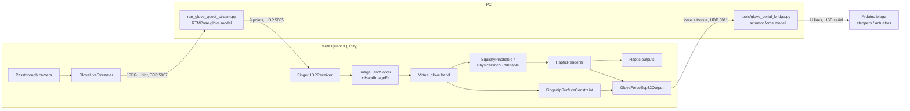

# Architecture

## Data flow

### 1. Camera to virtual hand (`Assets/Scripts/Tracking/`)

1. **GloveLiveStreamer** grabs the passthrough camera image (GPU readback, non-blocking), and on a worker thread
   halves it, JPEG-encodes it and sends it over TCP with a 24-byte header: frame id and where the Quest thinks the hand
   is in the image (a search hint for the model). It remembers the camera pose for every frame id.
2. The PC program finds 9 points on the glove (wrist, 4 on the thumb, 4 on the index finger) and sends them back over
   UDP with the frame id.
3. **FingerUDPReceiver** receives the points. Right after the Quest's `HandVisual` writes its own (unreliable) hand pose,
   it calls **ImageHandSolver**, which turns each point into a ray from the camera *as it was when that frame was
   captured* and asks **HandImageFit** to find the wrist pose and joint angles that put every virtual joint on its ray
   (Levenberg-Marquardt; bone lengths, joint limits and a pose prior learned from bare hands fill in the missing depth).
4. ImageHandSolver filters the result (One Euro filter, two display smoothing stages, extrapolation) and writes it to
   the hand bones. The middle, ring and little fingers stay curled; the Quest only contributes the hand depth hint and
   a fallback hand when the model loses the glove.
5. **CameraFrameCue** warns the user (orange hand, arrow, camera frame) when the hand drifts out of the camera view.

End-to-end latency (camera exposure to the virtual hand on screen) is about 194 ms; `tools/analysis/latency_breakdown.py`
splits it into stages from `glove_latency_*.csv`.

### 2. Virtual hand to force (`Interaction/`, `Haptics/`)

1. **SquishyPinchable** (soft ball) and **PhysicsPinchGrabbable** (rigid cube) decide when the hand grabs and releases
   them and how far they are compressed.
2. **HapticRenderer** measures how deep each *real* fingertip is inside an object (god-object method: the virtual
   finger stays on the surface, the gap to the real finger is the force), turns it into a 0..1 pressure plus short
   pulses on touch / grab / release, and sends them to every `IHapticGlove` output (controller vibration, fingertip
   colour cue, debug output).
3. **FingertipSurfaceConstraint** then bends the virtual fingers so they rest on the surface instead of going through it.
4. **GloveForceEsp32Output** (with **GloveEsp32Protocol**) sends the glove's force targets to the relay: per finger,
   contact, pad force and tilt, dorsal extension torque and actuator length. The force is faded out when tracking is
   poor (`ImageHandSolver.ForceWeight`).

### 3. Relay to actuators (`tools/`, `arduino/`)

The relay converts the dorsal torque into a target actuator pressure with the fitted actuator model
(`tools/actuator_model/`, run backwards by `tools/dorsal_pressure.py`) and streams `H` lines to the Arduino Mega, which
turns pressure into stepper positions (`arduino/glove_mega_steppers/`). Both sides fall back to rest pressure if their
input stops for 200 ms.

## Script reference

Execution order matters: the hand is built first, objects react to it, forces are computed from the *real* fingertips,
and only then are the virtual fingers pushed onto the surfaces. The numbers are `DefaultExecutionOrder`.

### Tracking

| Script | Order | What it does |
|---|---|---|
| `GloveLiveStreamer` | 0 | Streams the camera to the PC; keeps camera pose, hand hint and timestamps per frame id; provides rays through image points |
| `FingerUDPReceiver` | 0 | Receives the model's points; runs ImageHandSolver after HandVisual; curls the other three fingers; writes `glove_diag_*.csv` |
| `ImageHandSolver` | (called) | Solves one hand pose per image result, filters it, blends with the Quest hand when the glove is lost |
| `HandImageFit` | (plain C#) | The image-to-hand fit itself (14 unknowns, Levenberg-Marquardt) |
| `FingerChainFitter` | (plain C#) | Kinematics of one finger: joint angles <-> joint positions, flexion axes, joint limits |
| `GloveWristStabilizer` | (hand data chain) | Rejects the Quest's wrist jumps on the gloved hand and smooths it; records the raw Quest wrist |
| `HandFingerRig` | 0 | Finds and holds the finger bones of the hand model |
| `IsdkFingertipProxy` | 50 | Moves fingertip transforms to the bare left hand's tracked tips, so objects work with a bare hand too |
| `CameraFrameCue` | 400 | Visual cue when the hand nears or leaves the camera view |
| `GloveLatencyLog` | (plain C#) | Writes `glove_latency_*.csv` for FingerUDPReceiver |

### Interaction

| Script | Order | What it does |
|---|---|---|
| `SquishyPinchable` | 100 | Soft deformable object: dents, grab / release with two fingers, symmetric pinch |
| `PhysicsPinchGrabbable` | 100 | Rigid physics object: antipodal grab, throw on release |
| `FingertipSurfaceConstraint` | 200 | Keeps virtual fingers on object surfaces; parallel fingertips when pinching a ball |
| `SqueezeCueTint` | 300 | Object turns red when the real fingers squeeze past its maximum compression |
| `FingertipColorCue` | 350 | Fingertips turn red with force (an `IHapticGlove` output) |
| `PlaceInFrontOfHead` | 0 | Places the objects' home in front of the user at start and on the B button |

### Haptics

| Script | Order | What it does |
|---|---|---|
| `IHapticGlove` | - | Interface every haptic output implements (continuous pressure + event pulses) |
| `HapticRenderer` | 150 | Contact depth -> pressure and pulses, sent to the outputs; equal forces in a two-finger pinch |
| `HapticMaterial` | - | Per-object feel: pressure vs. compression, pulse shapes, maximum force in newtons |
| `ControllerVibrationOutput` | 300 | Renders the haptic signals on the Quest controller |
| `HapticDebugOutput` | 0 | Shows the haptic signals in the Inspector / Console |
| `GloveForceEsp32Output` | 210 | Sends force targets to the glove relay (UDP 5011), reads its telemetry |
| `GloveEsp32Protocol` | - | Packet layout shared with the relay and the boards |

### Experiments and measurement

| Script | Order | What it does |
|---|---|---|
| `StiffnessDiscriminationExperiment` | 400 | Two-ball stiffness discrimination task, writes trial and event CSVs |
| `ExperimentCsvWriter` | - | CSV writer that flushes every row |
| `GraspLogger` | 0 | Logs bare-hand tracking and grab state every frame (`GraspLog_*.csv`) |
| `GloveFingerLengthMeter` | 450 | Measures thumb and index length with the glove on (input to the actuator force model) |
| `HandPoseRecorder` | 1000 | Records bare-hand joint poses (used to learn HandImageFit's pose prior) |

## Network ports

| Port | Direction | Content |
|---|---|---|
| UDP 5008 | PC -> headset (broadcast) | `GLOVE_SERVER\|<tcp port>` discovery beacon |
| TCP 5007 | headset -> PC | Length-prefixed JPEG frames with the 24-byte `GLV1` header |
| UDP 5005 | PC -> headset | Text packet `valid:..,fid:..,pv:x\|y;..,pc:..,tm:..` with the 9 points |
| UDP 5011 | headset -> relay | 16 float32 force command, protocol version 3 |
| UDP 5012 | relay -> headset | 16 float32 telemetry / announce |

## Logs written on the headset

All in `Application.persistentDataPath` (`/sdcard/Android/data/<package>/files/`):

| File | Written by | Analysed by |
|---|---|---|
| `glove_diag_*.csv` | FingerUDPReceiver (Log Diagnostics) | `tools/analysis/latency_diag.py`, `filter_sim.py`, `quest_raw_feasibility.py` |
| `glove_latency_*.csv` | GloveLatencyLog (Log Diagnostics) | `tools/analysis/latency_breakdown.py` |
| `glove_finger_lengths_*.csv` | GloveFingerLengthMeter | `tools/analysis/glove_finger_lengths.py` |
| `Experiments/*_trials.csv`, `*_events.csv` | StiffnessDiscriminationExperiment | - |
| `hand_pose_*.csv` | HandPoseRecorder | `HandImageFitBench.RetargetQuest` |
| `GraspLog_*.csv` | GraspLogger | - |
